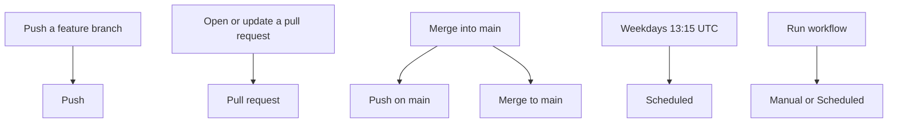

# How GitHub Actions work

This repository is a small Python library plus the workflows that run it. The library describes what GitHub is doing. The workflows are the part GitHub actually executes. Read a workflow, push a branch, then compare that file with the log.

Create a **new** GitHub repository from this folder, with `main` as the default branch. This directory sits next to other projects; commit it on its own.

## The words

A **workflow** is a YAML file in `.github/workflows/`. GitHub starts a **run** of that file when an event matches its `on:` block. A run is one row in the Actions tab.

A run is made of **jobs**. Jobs run in parallel unless one lists `needs:`. Each job gets a fresh `ubuntu-latest` machine. **Steps** run in order on that machine. A step is either `run:` (a shell command) or `uses:` (an action, a composite action, or another workflow).

The **check** you see on a commit or a pull request is a job. A red job is a failed check. Branch protection is what turns a red check into a merge button that stays disabled. Until you add that rule, GitHub still records the failure and still lets you merge.

| Word | In this repo |
| --- | --- |
| Workflow | `.github/workflows/push.yml` and the files next to it |
| Event | `push`, `pull_request`, `schedule`, `workflow_dispatch` |
| Job | `Unit tests`, `Merge gate`, `Explain this run` |
| Action | `actions/checkout@v4`, `actions/upload-artifact@v4` |
| Composite action | `.github/actions/setup` installs uv and syncs the lockfile |
| Reusable workflow | `explain.yml` and `pytest.yml`, called with `uses:` |
| Concurrency group | a new push cancels the in-progress Push run for that branch |
| Artifact | `test-results.xml`, kept 14 days on the run summary |
| Job summary | the Markdown box on a job, written by `python -m test_actions` |

`permissions` limits the `GITHUB_TOKEN` for that run. `contents: read` is enough to check out the repo. `actions: write` is what uploads the pytest report.

## What starts



| You do this | Workflow | Pytest markers | What you are reviewing |
| --- | --- | --- | --- |
| Push any branch | Push | `unit`, `integration` | A branch update with no pull request yet |
| Open a pull request into `main` | Pull request | `unit`, `integration`, `merge_gate` | The checks that can block the merge |
| Open a pull request into any other branch | Pull request | `unit`, `integration` | Merge gate is skipped |
| Push again while that pull request is open | Push **and** Pull request | both of the above | Two runs, two event names, one git push |
| Merge the pull request | Push, Merge to main, and a closed Pull request run | `post_merge` on the main push | The pull request can be green and `main` can still go red |
| Close a pull request without merging | Pull request, action `closed` | none | Explain this run says the base branch was left unchanged |
| Wait until 13:15 UTC on a weekday | Scheduled | `unit`, `scheduled` | Event name `schedule` |
| Actions → Scheduled → Run workflow | Scheduled | `unit`, `scheduled` | Event name `workflow_dispatch`. One cron assertion skips |
| Actions → Manual | Manual | the suite you pick | A red log without a new commit |

Unit tests on Push and on pull requests into any base run on Python 3.11 and 3.12. `fail-fast: false` means a 3.11 failure still lets 3.12 finish, so you can compare the two logs. The other suites stay on 3.12.

## How to read a run

1. Open the Actions tab and pick the workflow name: Push, Pull request, Merge to main, Scheduled, or Manual.
2. The run title already has the branch, the pull request number, or the event.
3. Open **Explain this run**. The log and the job summary are the same Markdown. The table is the raw `GITHUB_*` context for that event.
4. Open a test job for the pytest traceback. `-ra` prints the skip reason under the summary, which is how a skipped merge gate or a skipped cron assertion explains itself.
5. On the run summary, download the artifact. It is the junit XML for that marker and Python version. Failed tests are uploaded too, because the upload step uses `if: ${{ !cancelled() }}`.

A cancelled Push run means a newer push to the same ref won the concurrency group. The cancelled log is the previous commit. Merge to main does not cancel: each SHA keeps its own result.

## Push, pull request, and merge

These are three events. A merge produces more than one of them.

**Push.** `git push` sends `push`. `GITHUB_REF` is `refs/heads/<branch>`. `GITHUB_SHA` is the tip commit you pushed. `GITHUB_HEAD_REF` and `GITHUB_BASE_REF` are empty. `push.yml` listens to every branch, written as `"**"`. A tag push does not match that filter.

**Pull request.** Opening, editing, or pushing to the head branch sends `pull_request`. The `action` is `opened`, `synchronize`, `reopened`, or `closed`. On this event `GITHUB_REF` is `refs/pull/<number>/merge` and `GITHUB_SHA` is a temporary merge of your branch into the base. The branch name you created is `GITHUB_HEAD_REF`. The target is `GITHUB_BASE_REF`. `GITHUB_REF_NAME` looks like `7/merge`. Explain this run prints both SHAs so you can see the difference.

**Merge.** Merging a pull request closes it and pushes the base branch.

- Pull request runs again with `action: closed`. Tests are skipped. If `merged` is true, the explanation points you at the push runs.
- Push runs because `main` moved.
- Merge to main runs because that push was to `main`. This is the workflow whose tests are allowed to fail after the pull request was green.

A pull request from a fork still runs `pull_request` (on the base repository's workflow, with a read-only token). A push of the fork branch does not run Push in this repository, because the branch is not here. Use a branch in this repository when you want to see Push and Pull request side by side.

## Tests that fail on a merge

The merge gate and the post-merge check are different pytest markers, started by different workflows.

**Fail the pull request, before the merge.** Either of these turns **Merge gate** red. Unit and integration stay green.

- Create the branch `demo/fail-merge` (or `demo/fail-merge/anything`) and open a pull request into `main`.
- Or uncomment the example line in `config/merge_blockers.txt` and push that branch.

Require the check if you want GitHub to disable the merge button. After the first pull request has run once: Settings → Branches → Add branch ruleset (or classic protection) for `main` → require status checks → search for `Merge gate`. The check name appears only after GitHub has seen it. The full name looks like `Merge gate / Python 3.12`.

**Fail `main`, after the merge.** The pull request workflow never runs the `post_merge` marker.

- Uncomment the example line in `config/post_merge_failures.txt`, open a pull request, watch it pass, then merge. **Post-merge checks** on Merge to main goes red and stays red until a later commit on `main` comments that line out again.
- Or, in the merge dialog, put `[fail-post-merge]` in the tip commit message. That one commit fails. The next commit to `main` without the token passes. The red run stays in the Actions history.

**Fail a run without pushing.** Actions → Manual.

- Suite `merge_gate`, pretend branch `demo/fail-merge`.
- Suite `post_merge`, commit message containing `[fail-post-merge]`.
- Any suite with **Fail this run on purpose** checked. That sets `SIMULATE_FAILURE=1`.

Preview the same failures locally:

```bash
uv sync
ACTIONS_EXAMPLE_EVENT=pull_request \
ACTIONS_EXAMPLE_BASE_REF=main \
ACTIONS_EXAMPLE_HEAD_REF=demo/fail-merge \
uv run pytest -m merge_gate

ACTIONS_EXAMPLE_EVENT=push \
ACTIONS_EXAMPLE_REF_NAME=main \
ACTIONS_EXAMPLE_COMMIT_MESSAGE='land on main [fail-post-merge]' \
uv run pytest -m post_merge
```

`uv run pytest` with no marker runs every suite. Locally the event is `local`, so the branch-name and commit-message tests skip, and the config files are still checked. `uv run python -m test_actions` prints the explanation for whatever `ACTIONS_EXAMPLE_*` you exported.

## Schedule

`scheduled.yml` uses one cron expression:

```yaml
- cron: '15 13 * * 1-5'
```

The fields are minute, hour, day of month, month, day of week. This one is 13:15 UTC, Monday through Friday. In UTC−3 that is 10:15. The same string lives in `src/test_actions/cron.py` as `WEEKDAY_AFTERNOON`. `describe_cron` turns it into a sentence, and a test fails if the workflow and the constant drift.

GitHub only starts `schedule` from the **default branch**. Changing the cron on a feature branch does nothing until that change is on `main`. A repository with no workflow runs for 60 days has its schedules disabled until someone starts a workflow again. The clock can slip past 13:15 during busy periods; the run still shows `schedule` when it starts.

Day-of-month and day-of-week are both unrestricted here except the weekday range. If you set both fields to something other than `*`, GitHub treats them as OR. `describe_cron` rejects that shape so the sentence cannot hide the footgun.

The Run workflow button on Scheduled is `workflow_dispatch`. `test_this_run_was_started_by_cron` skips on that button and passes on the weekday run. That skip line is the thing to compare when you review the two logs.

## Try it in this order

1. Push `main`. Expect a Push run and a Merge to main run. Explain this run on the main push lists both workflows.
2. Branch `feature/logs`, change a comment, push. Expect only Push.
3. Open a pull request from `feature/logs` into `main`. Expect Pull request, including Merge gate.
4. Push another commit to `feature/logs`. Expect a new Push run and a Pull request run whose action is `synchronize`.
5. Open a pull request into a branch other than `main`. Merge gate is skipped. The skip is visible on the run graph.
6. Branch `demo/fail-merge`, open a pull request into `main`, and read the red Merge gate traceback. Leave it unmerged.
7. On a normal branch, uncomment `config/post_merge_failures.txt`, merge a green pull request, then read Post-merge checks. Comment the line back out on `main` so later pushes go green.
8. Run Scheduled from the Actions tab and read the skipped cron test. On the next weekday after 13:15 UTC, open the run whose event is `schedule` and see that test pass.
9. Run Manual with simulate failure when you want another red log without touching a branch.

## Where each idea lives

| Idea | File |
| --- | --- |
| When a workflow starts | the `on:` block of `push.yml`, `pull-request.yml`, `merge-main.yml`, `scheduled.yml`, `manual.yml` |
| Which suites those events imply | `src/test_actions/rules.py` |
| The log you read first | `src/test_actions/explain.py`, called as `python -m test_actions` |
| Shared checkout, uv, pytest, artifact | `.github/workflows/pytest.yml` |
| Shared install steps | `.github/actions/setup/action.yml` |
| Python versions side by side | `python_versions` on the unit job, `strategy.matrix` inside `pytest.yml` |
| A job that runs only after a failure | `where-to-look` in `pull-request.yml`. `if: always()` is required because a skipped Merge gate would otherwise hide the failure |
| Switches you edit by hand | `config/merge_blockers.txt`, `config/post_merge_failures.txt` |

Commit messages and pull request titles are passed in environment variables. The shell steps do not paste those strings into the script.

## What this repo leaves alone

These are real Actions features, and they are not wired up here.

- **Environments** (`environment:`) add required reviewers and environment-scoped secrets before a job starts. Use them for deploys.
- **OIDC** (`id-token: write`) lets a job assume a cloud role without a long-lived key.
- **Reusable workflows in another repository** use `owner/repo/.github/workflows/name.yml@ref`. The calls here stay inside this repo (`./.github/workflows/pytest.yml`).
- **Path filters** (`on.push.paths`) skip a workflow when only some files changed. Every push here runs, so a README edit still produces a log.
- **Services and containers** start databases or replace the job VM. These jobs use the hosted Ubuntu image.
- **Cache** beyond uv is `actions/cache`. The setup action already caches the uv download.
- **Matrix `include` / `exclude`** build a custom grid. The matrix here is only the Python version.
- **Deployment protection and environment branches** restrict which branch may deploy. Branch rulesets are the piece that makes Merge gate mandatory, and you turn that on in the repository settings.
